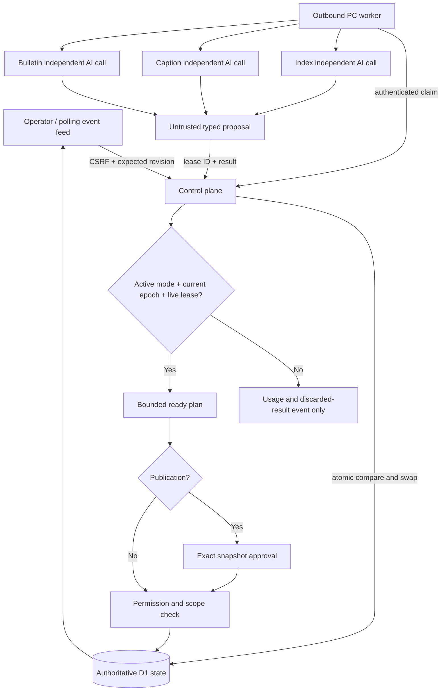

# A control plane that owns the write

Every externally visible action in this prototype is a record mutation inside the authoritative workspace state. The PC does not directly modify programme records. It only submits proposed plans and asks the control plane to tick. Even a previously claimed plan cannot execute after the operator changes its epoch. Every compare-and-swap includes the prior database revision; a concurrent mutation must reload before it can commit.

The three agents plan independently and can overlap in time. A returned model plan is validated against an exact field allowlist and known record IDs. Execution rechecks live mode before each step. Bulletin's channel is checked again at execution, and publication requires a pending exact approval with the live epoch and unchanged source record version. Approval commits one frozen snapshot and advances one cursor atomically. A publication is never implemented by a raw model tool call.

Operator requests carry idempotency identities. A repeated request returns the committed current state; it does not duplicate the operation. Export strips internal request history and active lease capabilities. The service credential is not in public state. The fictional-team boundary is enforced by the server; no caller-controlled target workspace is accepted in browser commands.

The event window contains sequence, time, run, agent, decision summary, proposed action, before/after records and client-reported usage where available. Replay reads this retained history; it does not reconstruct hidden reasoning or imply immutable third-party timestamps. Polls have monotonic workspace revisions; switching teams invalidates older in-flight UI responses.

Local SQLite tests exercise the same D1-shaped queries. Actual public D1 behavior, genuine client calls and browser interventions must be verified separately before final release. The prototype is a demonstrable control-plane boundary, not a claim that killing an arbitrary external agent process reverses already completed effects or refunds inference.
