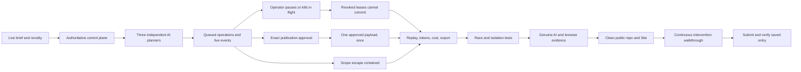

# Switchyard methodology map

Mission: [The Agent Control Tower](https://build.doo.ooo/challenges/agent-control-tower), inspected live October 19, 2026. This is the eighth distinct mission; the first seven are covered by separate prototypes.

**Product.** A railway-inspired operations board for a fictional film festival. Index cleans catalogue titles; Caption writes accessibility descriptions from supplied text briefs; Bulletin proposes publication to the festival's simulated programme. Each independently asks DeepSeek for a bounded plan. Actual asynchronous workers execute typed operations through one control plane. The display reads durable events, not a pre-scripted animation. Public AI remains dependent on the approved PC backend.

**Novelty.** This is fleet intervention, not the company operating loop, delegated reputation, adaptive planning, memory, editorial proof or SQL rehearsal. A dark signal board uses lanes, switching points, a dispatch queue and a replay strip rather than recycling prior page layouts.

**Critical invariant.** Pause and kill revoke the execution epoch immediately. A late model result or old worker lease cannot commit a record mutation. Provider work may already have incurred charges; stopping execution is not a promise of refunded tokens. Kill is terminal for that run; pause is reversible. Approval binds one exact payload and resource version, rather than granting open-ended permission.

**Failure.** The injected rogue Bulletin proposal targets the other team's publication channel. It is labeled injected and retained alongside the original genuine plan. The server refuses and quarantines the agent, and the other team's records must remain unchanged.

**Verification order.** Domain invariants → concurrent lease/approval/isolation tests → actual three-agent AI runs → live pause/kill/late result and rogue containment → desktop/mobile browser checks → cost/evidence audit → clean source and production build → publication → saved entry. Model doubles and real provider evidence remain distinct.

**Usage boundary.** User instructed stop at 20% remaining of the five-hour allowance (80% used). Save a resumable checkpoint if reached before completion. No new entry has been submitted yet.
